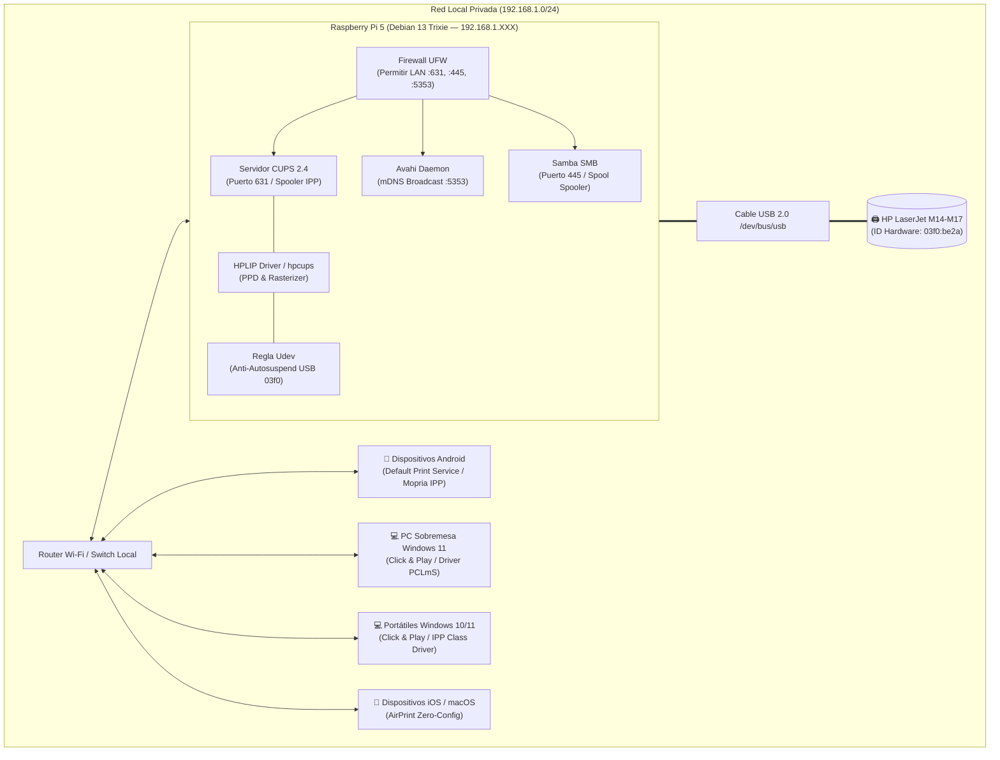

# 🖨️ Raspberry Pi 5 Centralized Print Server & HP LaserJet Automation

[-C51A4A?style=for-the-badge&logo=raspberrypi&logoColor=white)](https://www.raspberrypi.com)
[-D70A53?style=for-the-badge&logo=debian&logoColor=white)](https://www.debian.org)
[](https://www.cups.org)
[](https://developers.hp.com/hp-linux-imaging-and-printing)
[](https://avahi.org)
[](https://www.samba.org)
[](https://www.microsoft.com/windows)
[](https://aaronsgomez.github.io/rpi5-cups-print-server/)
[](LICENSE)

> **Resumen Ejecutivo**:  
> Solución integral, ligera y automatizada para transformar una **Raspberry Pi 5 (8 GB RAM, ARM64 / Debian Linux)** en un servidor de impresión local de alto rendimiento y alta disponibilidad. Conecta y gestiona de forma centralizada impresoras USB de la gama **HP LaserJet serie M14-M17** (incluyendo M15a, M15w, M28a y equivalentes basados en HPLIP/hpcups).  
> El sistema implementa descubrimiento nativo **Zero-Config** para dispositivos móviles (**Android Mopria / Apple AirPrint / IPP Everywhere**), instaladores **Click & Play** de un solo clic para clientes **Windows 10 y 11**, compartición nativa **Samba**, apertura estricta de firewall **UFW** y mitigación de hardware a nivel de kernel mediante **reglas Udev** para erradicar el congelamiento por reposo profundo (*deep sleep / USB autosuspend*).

---

## 📖 Documentación y Guías Rápidas del Proyecto

| Recurso | Enlace Directo | Destinado a | Descripción |
| :--- | :--- | :--- | :--- |
| **🌐 Portal Web Interactivo (Online)** | [**aronsgomez.github.io/rpi5-cups-print-server**](https://aaronsgomez.github.io/rpi5-cups-print-server/) | Administradores y Usuarios | Web en vivo: topología interactiva, buscador de drivers multimarca y emulador de consola |
| **📱 Guía de Impresión Móvil** | [**`docs/GUIA_IMPRESION_MOVIL.md`**](docs/GUIA_IMPRESION_MOVIL.md) | Teléfonos Android & iPhone/iPad | Paso a paso para imprimir desde WhatsApp, PDFs, Chrome y Gmail con Zero-Config o IP directa |
| **💻 Cliente Windows Click & Play** | [`Cliente_Windows_ClickAndPlay/`](Cliente_Windows_ClickAndPlay/) | Equipos Windows 10 y 11 | Instalador portátil en 1 clic para configurar PCs y portátiles del hogar sin introducir contraseñas |
| **🚀 Despliegue del Servidor** | [`setup_cups_server.sh`](setup_cups_server.sh) | Raspberry Pi 5 (Debian 13) | Script Bash modular, deshabilitador de `ipp-usb`, Udev anti-sleep y autoconfiguración CUPS |
| **🔧 CLI de Control Remoto** | [`deploy_remote.py`](deploy_remote.py) | PC Administrador | Monitoreo de salud (`--status`), reconfiguración (`--fix-ppd`) y páginas de prueba remotas |

---

## 🌐 Especificaciones del Entorno y Puertos de Servicio

| Componente | Versión / Detalle | Protocolo / Puerto | Función Principal |
| :--- | :--- | :---: | :--- |
| **Servidor Host** | Raspberry Pi 5 (8 GB RAM, ARM64 BCM2712) | SSH (`22/tcp`) | Host del servidor de impresión central |
| **Servicio de Impresión** | CUPS 2.4.x | IPP / HTTP (`631/tcp`) | Spooler central, interfaz web y protocolo IPP Everywhere |
| **Descubrimiento de Red** | Avahi Daemon 0.8+ | mDNS / DNS-SD (`5353/udp`) | Publicación de colas `.local` para móviles y PCs |
| **Compartición Windows** | Samba 4.x (Suite smbd) | SMB (`445/tcp`, `139/tcp`) | Compatibilidad legacy y spooling directo de Windows |
| **Controlador Impresora** | HPLIP + hpcups + udev rule | USB (`03f0:be2a`) | Driver rasterizador y prevención de suspensión USB |
| **Seguridad de Red** | Linux UFW Firewall | Reglas de subred LAN | Aislamiento y acceso autorizado exclusivamente a la LAN |

---

## ✨ Características Principales

### 📱 1. Descubrimiento Nativo Zero-Config (Móviles Android & iOS)
- Anuncio automático vía **mDNS / DNS-SD** (`_ipp._tcp`, `_pdl-datastream._tcp`).
- Compatible de forma transparente con el **Servicio de Impresión Predeterminado de Android** y la suite **Mopria Print Service** sin requerir drivers ni apps propietarias.
- Soporte para **Apple AirPrint** (iOS / iPadOS / macOS) sin configuración manual.
- Guía de contingencia para redes Wi-Fi con aislamiento de punto de acceso (**AP Isolation / Multicast Filtering**).

### 💻 2. Instalador de Cliente Windows "Click & Play"
- Paquete portátil e independiente en [`Cliente_Windows_ClickAndPlay`](Cliente_Windows_ClickAndPlay/):
  - **`INSTALAR_IMPRESORA.bat`**: Lanzador con auto-elevación transparente de Administrador (UAC).
  - **`Instalar_Impresora.ps1`**: Script inteligente en PowerShell que sondea el servidor en la LAN, detecta el mejor controlador instalado (`HP LaserJet M14-M17 PCLmS`, `Microsoft IPP Class Driver` o `Microsoft PCL6 Class Driver`), crea la cola local IPP y envía una página de prueba.
  - **`DESINSTALAR_IMPRESORA.bat`**: Desinstalación limpia en un clic para equipos temporales o invitados.

### 🛡️ 3. Mitigación Hardware del Reposo Profundo y Desbloqueo USB (ipp-usb EBUSY Fix)
- **El Problema 1 (Bloqueo exclusivo USB)**: En distribuciones modernas (Debian 12/13, Ubuntu), el servicio `ipp-usb` intenta reclamar de forma exclusiva el bus USB de la impresora. Al tratarse de un modelo host-based (M14-M17 / M15a), `ipp-usb` bloquea el puerto impidiendo que el controlador HPLIP envíe datos (`Channel write error: Device or resource busy`).
- **El Problema 2 (Reposo profundo / Standby)**: Tras unos minutos de inactividad, la placa entra en suspensión y CUPS por defecto aplicaría `ErrorPolicy stop-printer`, desactivando permanentemente la cola (`Paused / Filter failed`).
- **Nuestra Solución Integral Implementada**:
  1. Enmascaramiento y desactivación de `ipp-usb` (`systemctl mask ipp-usb`) para otorgar acceso USB directo e ininterrumpido a HPLIP.
  2. Asignación directa del controlador oficial mono PCLmS `hplip:0/ppd/hplip/HP/hp-laserjet_m14-m17.ppd`.
  3. Configuración de cola con política **`printer-error-policy=retry-job`**.
  4. Regla udev en `/etc/udev/rules.d/99-hp-no-autosuspend.rules` forzando `ATTR{power/control}="on"` y `ATTR{power/autosuspend}="-1"`.
  5. Watchdog y script de desbloqueo rápido (`cupsenable` & `cupsaccept`).

### 🔒 4. Seguridad, Variables en `.env` y Cero Exposición
- Todas las credenciales del servidor (`RPI_HOST`, `RPI_USER`, `RPI_PASSWORD`) se gestionan mediante variables de entorno en [.env](.env.example).
- Configuración estricta en [.gitignore](.gitignore) que bloquea `.env`, credenciales y logs.
- Herramienta unificada de despliegue y monitoreo remoto [deploy_remote.py](deploy_remote.py) basada en `paramiko`.

---

## 📐 Topología y Flujo de Comunicación



---

## 🚀 Despliegue Rápido del Servidor

### Opción 1: Despliegue Remoto Automatizado (Desde PC Administrador)
1. Clona el repositorio y copia el archivo de entorno:
   ```bash
   cp .env.example .env
   ```
2. Edita `.env` con las credenciales de tu Raspberry Pi 5:
   ```ini
   RPI_HOST=192.168.1.XXX
   RPI_PORT=22
   RPI_USER=tu_usuario
   RPI_PASSWORD=tu_password_seguro
   PRINTER_QUEUE_NAME=HP_LaserJet_M14_M17
   ```
3. Ejecuta el despliegue automático:
   ```bash
   python deploy_remote.py --deploy
   ```
4. Comprueba la salud del servidor y colas:
   ```bash
   python deploy_remote.py --status
   ```

---

### Opción 2: Despliegue Directo en la Raspberry Pi 5
Si accedes directamente por terminal a la Raspberry Pi:
```bash
sudo bash setup_cups_server.sh
```

El script se encarga de:
- Instalar todos los paquetes necesarios del sistema operativo.
- Configurar `/etc/cups/cupsd.conf` con directivas de compartición y permisos `@LOCAL`.
- Desplegar la regla udev contra la autosuspensión USB.
- Inyectar las directivas CUPS en `/etc/samba/smb.conf`.
- Abrir los puertos correspondientes en el firewall UFW.
- Habilitar y arrancar los servicios en `systemctl`.
- Detectar la impresora conectada y crear la cola de impresión compartida.

---

## 💻 Configuración en Clientes Windows (Click & Play)

Para cualquier equipo Windows 10 o Windows 11 del hogar:

1. Abre la carpeta [`Cliente_Windows_ClickAndPlay`](Cliente_Windows_ClickAndPlay/).
2. Haz doble clic sobre **`INSTALAR_IMPRESORA.bat`**.
3. Acepta el aviso de Administrador de Windows (UAC).
4. El script configurará automáticamente la cola `HP LaserJet M14-M17 (Red Hogar)` y te permitirá imprimir una página de prueba.

---

## 📱 Configuración en Dispositivos Móviles (Android & iOS)

> 📘 **Guía detallada con capturas y pasos por app:** Consulta el manual completo en [**`docs/GUIA_IMPRESION_MOVIL.md`**](docs/GUIA_IMPRESION_MOVIL.md).

### 🤖 1. Android (Detección Automática Zero-Config / Mopria)
1. Conecta el dispositivo a la red Wi-Fi de la vivienda.
2. Ve a **Ajustes > Conexiones (o Dispositivos conectados) > Preferencias de conexión > Impresión**.
3. Activa el **Servicio de impresión predeterminado** (o **Mopria Print Service**).
4. Al imprimir cualquier documento o foto desde WhatsApp, Chrome o el visor PDF, selecciona:
   `HP_LaserJet_M14_M17 @ tu_usuario`.

### ⚡ 2. Android: Fallback Manual por Dirección IP (Sortear AP Isolation del Router)
Si tu router Wi-Fi tiene activado el *Aislamiento de Clientes (AP Isolation)* y no muestra impresoras mDNS:
1. En el menú de impresión de Android, pulsa los **3 puntos (menú)** > **Agregar impresora**.
2. Selecciona **Agregar por dirección IP**.
3. Introduce:
   * **Host:** `192.168.1.XXX`
   * **URL IPP Directa:** `http://192.168.1.XXX:631/printers/HP_LaserJet_M14_M17`

### 🍏 3. iPhone y iPad (Apple AirPrint Nativo)
Gracias a la difusión DNS-SD de Avahi, iOS detecta la impresora sin apps adicionales:
1. Conéctate a la red Wi-Fi del hogar.
2. Abre cualquier archivo > Pulsa **Compartir** > **Imprimir**.
3. Selecciona `HP_LaserJet_M14_M17` y pulsa **Imprimir**.

---

## 🛠️ Comandos Útiles y Diagnóstico

### Herramienta CLI `deploy_remote.py`
```bash
# Ver estado de colas, servicios y puertos en la Pi 5
python deploy_remote.py --status

# Desplegar / actualizar el servidor remotamente
python deploy_remote.py --deploy

# Enviar una impresión de prueba directa desde la Pi 5
python deploy_remote.py --test-page

# Reanudar la cola si se pausó por desconexión física
python deploy_remote.py --unstick
```

### Comandos de Diagnóstico en Linux
| Objetivo | Comando |
| :--- | :--- |
| **Comprobar estado de colas** | `lpstat -p -d` |
| **Comprobar si el planificador CUPS corre** | `lpstat -r` |
| **Ver trabajos pendientes o en error** | `lpstat -o` |
| **Verificar dispositivo USB conectado** | `lsusb \| grep -i 03f0` |
| **Detectar URI oficial con HPLIP** | `sudo hp-probe -b usb` |
| **Reactivar cola atascada manualmente** | `sudo cupsenable HP_LaserJet_M14_M17 && sudo cupsaccept HP_LaserJet_M14_M17` |
| **Cancelar todos los trabajos en cola** | `cancel -a -x` |

---

## 📂 Estructura del Proyecto

```text
server_print/
│
├── .env.example                               # Plantilla de variables de entorno seguras
├── .gitignore                                 # Protección estricta de credenciales y temporales
├── LICENSE                                    # Licencia MIT de código abierto
├── README.md                                  # Documentación técnica oficial y arquitectura
│
├── docs/                                      # Manuales y guías detalladas para usuarios
│   └── GUIA_IMPRESION_MOVIL.md                # Guía paso a paso para móviles Android e iOS / AirPrint
│
├── setup_cups_server.sh                       # Script Bash modular de despliegue en Raspberry Pi 5
├── deploy_remote.py                           # CLI de orquestación y monitoreo remoto (Paramiko)
│
├── setup_printer_client.bat                   # Lanzador para clientes Windows (raíz)
├── setup_printer_client.ps1                   # Script PowerShell de instalación para Windows
│
└── Cliente_Windows_ClickAndPlay/              # Paquete portátil e independiente para la familia
    ├── INSTALAR_IMPRESORA.bat                 # Doble clic con auto-elevación UAC
    ├── Instalar_Impresora.ps1                 # Lógica de detección IPP y asignación de drivers
    ├── DESINSTALAR_IMPRESORA.bat              # Script de limpieza y desinstalación
    └── LEEME_INSTRUCCIONES.txt                # Instrucciones sencillas en texto plano
```

---

## 📄 Licencia

Este proyecto se distribuye bajo la licencia **MIT**. Consulta el archivo [LICENSE](LICENSE) para más detalles.
