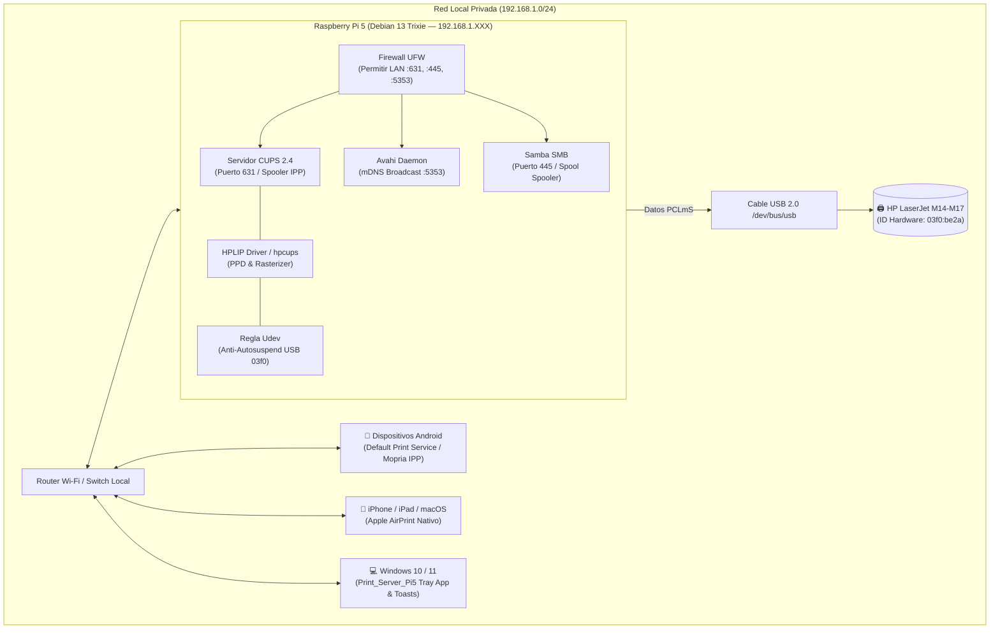
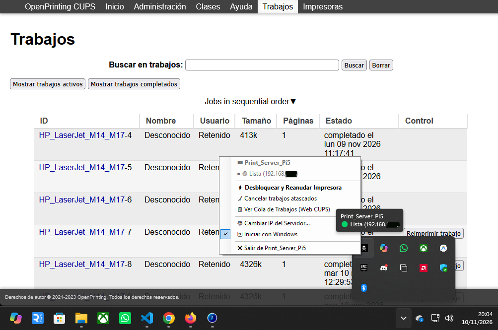

# Raspberry Pi 5 Centralized Print Server & HP LaserJet Automation

[-C51A4A?style=for-the-badge&logo=raspberrypi&logoColor=white)](https://www.raspberrypi.com)
[-D70A53?style=for-the-badge&logo=debian&logoColor=white)](https://www.debian.org)
[](https://www.cups.org)
[](https://developers.hp.com/hp-linux-imaging-and-printing)
[](https://avahi.org)
[](https://www.samba.org)
[](https://www.microsoft.com/windows)
[](https://aaronsgomez.github.io/rpi5-cups-print-server/)
[](LICENSE)

> **Resumen Ejecutivo**:  
> Solución integral, ligera y automatizada para transformar una **Raspberry Pi 5 (8 GB RAM, ARM64 / Debian Linux)** en un servidor de impresión local de alto rendimiento y alta disponibilidad. Conecta y gestiona de forma centralizada impresoras USB de la gama **HP LaserJet serie M14-M17** (incluyendo M15a, M15w, M28a y equivalentes basados en HPLIP/hpcups).  
> El sistema implementa descubrimiento nativo **Zero-Config** para dispositivos móviles (**Android Mopria / Apple AirPrint / IPP Everywhere**), instaladores **Click & Play** de un solo clic para clientes **Windows 10 y 11**, aplicación residente en la bandeja del sistema (**System Tray**) con notificaciones nativas Toast y botón de **recuperación de atascos en 1 clic**, compartición nativa **Samba**, apertura estricta de firewall **UFW** y mitigación de hardware a nivel de kernel mediante **reglas Udev** para erradicar el congelamiento por reposo profundo (*deep sleep / USB autosuspend*).

---

## Documentación y Guías Rápidas del Proyecto

| Recurso | Enlace Directo | Destinado a | Descripción |
| :--- | :--- | :--- | :--- |
| **Portal Web Interactivo (Online)** | [**aaronsgomez.github.io/rpi5-cups-print-server**](https://aaronsgomez.github.io/rpi5-cups-print-server/) | Administradores y Usuarios | Web en vivo: descarga directa del instalador Windows, topología interactiva, buscador de drivers y manual |
| **Descarga Directa Windows (.exe)** | [**`INSTALAR_PRINT_SERVER_PI5.exe`**](https://aaronsgomez.github.io/rpi5-cups-print-server/downloads/INSTALAR_PRINT_SERVER_PI5.exe) | Equipos Windows 10 y 11 | Ejecutable autónomo con el servicio e icono incrustados, sin tener que buscarlo en el repositorio |
| **Guía de Impresión Móvil** | [**`docs/GUIA_IMPRESION_MOVIL.md`**](docs/GUIA_IMPRESION_MOVIL.md) | Teléfonos Android & iPhone/iPad | Paso a paso para imprimir desde WhatsApp, PDFs, Chrome y Gmail con Zero-Config o IP directa |
| **Auditoría & SmartScreen Windows** | [**`docs/AUDITORIA_SEGURIDAD_WINDOWS.md`**](docs/AUDITORIA_SEGURIDAD_WINDOWS.md) | Usuarios Windows 10 y 11 | Qué ejecuta el instalador, verificación SHA-256 y guía para aceptar el aviso de SmartScreen |
| **Cliente Windows Click & Play 🏴‍☠️** | [`Cliente_Windows_ClickAndPlay/`](Cliente_Windows_ClickAndPlay/) | Equipos Windows 10 y 11 | Instalador todo-en-uno `.exe` con icono pirata, app de bandeja System Tray, avisos Toast y control de atascos |
| **Despliegue del Servidor** | [`setup_cups_server.sh`](setup_cups_server.sh) | Raspberry Pi 5 (Debian 13) | Script Bash modular, deshabilitador de `ipp-usb`, Udev anti-sleep y autoconfiguración CUPS |
| **CLI de Control Remoto** | [`deploy_remote.py`](deploy_remote.py) | PC Administrador | Monitoreo de salud (`--status`), reconfiguración (`--fix-ppd`) y páginas de prueba remotas |

---

## Especificaciones del Entorno y Puertos de Servicio

| Componente | Versión / Detalle | Protocolo / Puerto | Función Principal |
| :--- | :--- | :---: | :--- |
| **Servidor Host** | Raspberry Pi 5 (8 GB RAM, ARM64 BCM2712) | SSH (`22/tcp`) | Host del servidor de impresión central |
| **Servicio de Impresión** | CUPS 2.4.x | IPP / HTTP (`631/tcp`) | Spooler central, interfaz web y protocolo IPP Everywhere |
| **Descubrimiento de Red** | Avahi Daemon 0.8+ | mDNS / DNS-SD (`5353/udp`) | Publicación de colas `.local` para móviles y PCs |
| **Compartición Windows** | Samba 4.x (Suite smbd) | SMB (`445/tcp`, `139/tcp`) | Compatibilidad legacy y spooling directo de Windows |
| **Controlador Impresora** | HPLIP + hpcups + udev rule | USB (`03f0:be2a`) | Driver rasterizador y prevención de suspensión USB |
| **Seguridad de Red** | Linux UFW Firewall | Reglas de subred LAN | Aislamiento y acceso autorizado exclusivamente a la LAN |

---

## Características Principales

### 1. Descubrimiento Nativo Zero-Config (Móviles Android & iOS)
- Anuncio automático vía **mDNS / DNS-SD** (`_ipp._tcp`, `_pdl-datastream._tcp`).
- Compatible de forma transparente con el **Servicio de Impresión Predeterminado de Android** y la suite **Mopria Print Service** sin requerir drivers ni apps propietarias.
- Soporte para **Apple AirPrint** (iOS / iPadOS / macOS) sin configuración manual.
- Guía de contingencia para redes Wi-Fi con aislamiento de punto de acceso (**AP Isolation / Multicast Filtering**).

### 2. Clientes Windows 10 y 11: Dos Modos de Uso Disponibles
Por defecto, Windows entrega los datos a la Raspberry Pi y borra el trabajo de su cola local inmediatamente (*fire-and-forget*), dejando al usuario sin saber si el documento se imprimió o si la impresora se atascó.  
Para resolver esto, el paquete en [`Cliente_Windows_ClickAndPlay/`](Cliente_Windows_ClickAndPlay/) ofrece **dos modos de uso para que el usuario elija**:

* **Modo 1 (Recomendado / App con Icono Pirata 🏴‍☠️):**
  - **`INSTALAR_PRINT_SERVER_PI5.exe`** *(descargable directamente desde el [portal web](https://aaronsgomez.github.io/rpi5-cups-print-server/))*: Instalador autónomo que incluye `Print_Server_Pi5.exe` y `pirata.ico` incrustados en el propio ejecutable. Solicita la IP del servidor CUPS al usuario (si no existe `ip_servidor.txt`), comprueba la conexión con el puerto 631, registra la impresora, **despliega de forma permanente el software en `C:\Program Files\Print_Server_Pi5\`** (con acceso directo en el Menú Inicio y desinstalador automático), registra el arranque automático para todos los usuarios en `HKLM\SOFTWARE\Microsoft\Windows\CurrentVersion\Run` (64 bits) e inicia el monitor en la sesión gráfica del usuario activo.
  - **`Print_Server_Pi5.exe` (App de Bandeja / System Tray junto al reloj):**
    - 🖨️ **Notificaciones Toast nativas:** Avisos emergentes en tiempo real (*"Imprimiendo..."*, *"Completado con éxito"* y alarma sonora ante atascos).
    - ⚡ **Desbloqueo de atascos en 1 clic:** Cuando la impresora se atasca y CUPS detiene la cola por software, tras retirar el papel basta con hacer clic derecho en el icono pirata > **"Desbloquear y Reanudar Impresora"** para reactivar el servicio sin abrir consolas ni comandos.
    - 🧹 **Cancelar trabajos:** Opción de purgar documentos dañados.
    - 🔄 **Inicio automático y cambio de IP:** Configurable con casilla de verificación (compatible con `HKLM` y `HKCU`) y respaldo en `%LocalAppData%\Print_Server_Pi5\ip_servidor.txt` si se edita la IP sin permisos de administrador.

* **Modo 2 (Modo Ligero / Scripts por Lotes .bat y .ps1):**
  - Ubicado en la subcarpeta separada [`Scripts_Ejecucion_Manual/`](Cliente_Windows_ClickAndPlay/Scripts_Ejecucion_Manual/) para quienes no deseen aplicaciones residentes en segundo plano:
    - **`INSTALAR_IMPRESORA.bat`**: Registra la impresora en Windows Spooler.
    - **`REANUDAR_IMPRESORA.bat`**: Envía el comando de desbloqueo a la Raspberry Pi tras un atasco.
    - **`DESINSTALAR_IMPRESORA.bat`**: Retira la impresora del equipo.

### 3. Mitigación Hardware del Reposo Profundo y Desbloqueo USB (ipp-usb EBUSY Fix)
- **El Problema 1 (Bloqueo exclusivo USB)**: En distribuciones modernas (Debian 12/13, Ubuntu), el servicio `ipp-usb` intenta reclamar de forma exclusiva el bus USB de la impresora. Al tratarse de un modelo host-based (M14-M17 / M15a), `ipp-usb` bloquea el puerto impidiendo que el controlador HPLIP envíe datos (`Channel write error: Device or resource busy`).
- **El Problema 2 (Reposo profundo / Standby)**: Tras unos minutos de inactividad, la placa entra en suspensión y CUPS por defecto aplicaría `ErrorPolicy stop-printer`, desactivando permanentemente la cola (`Paused / Filter failed`).
- **Nuestra Solución Integral Implementada**:
  1. Enmascaramiento y desactivación de `ipp-usb` (`systemctl mask ipp-usb`) para otorgar acceso USB directo e ininterrumpido a HPLIP.
  2. Asignación directa del controlador oficial mono PCLmS `hplip:0/ppd/hplip/HP/hp-laserjet_m14-m17.ppd`.
  3. Configuración de cola con política **`printer-error-policy=retry-job`**.
  4. Regla udev en `/etc/udev/rules.d/99-hp-no-autosuspend.rules` forzando `ATTR{power/control}="on"` y `ATTR{power/autosuspend}="-1"`.
  5. Watchdog y script de desbloqueo rápido (`cupsenable` & `cupsaccept`).

### 4. Seguridad, Variables en `.env` y Cero Exposición
- Todas las credenciales del servidor (`RPI_HOST`, `RPI_USER`, `RPI_PASSWORD`) se gestionan mediante variables de entorno en [.env](.env.example).
- Configuración estricta en [.gitignore](.gitignore) que bloquea `.env`, credenciales y logs.
- Herramienta unificada de despliegue y monitoreo remoto [deploy_remote.py](deploy_remote.py) basada en `paramiko`.

---

## Topología y Flujo de Comunicación



---

## Despliegue del Servidor (Raspberry Pi 5)

### Opción 1: Despliegue Remoto Automatizado (Recomendada)
Desde cualquier PC con Python instalado:
1. Clona el repositorio y crea tu archivo `.env`:
   ```bash
   cp .env.example .env
   ```
2. Edita `.env` con las credenciales de tu Raspberry Pi 5:
   ```ini
   RPI_HOST=192.168.1.XXX
   RPI_PORT=22
   RPI_USER=tu_usuario
   RPI_PASSWORD=tu_password_seguro
   PRINTER_QUEUE_NAME=HP_LaserJet_M14_M17
   ```
3. Ejecuta el despliegue automático:
   ```bash
   python deploy_remote.py --deploy
   ```
4. Comprueba la salud del servidor y colas:
   ```bash
   python deploy_remote.py --status
   ```

---

### Opción 2: Despliegue Directo en la Raspberry Pi 5
Si accedes directamente por terminal a la Raspberry Pi:
```bash
sudo bash setup_cups_server.sh
```

El script se encarga de instalar paquetes, configurar `/etc/cups/cupsd.conf` con directivas `@LOCAL`, desplegar la regla udev contra autosuspensión USB, abrir firewall UFW y configurar la cola compartida.

---

## Instalación en Clientes Windows 10 y 11

### Paquete de Distribución Windows:
* [`Cliente_Windows_ClickAndPlay/`](Cliente_Windows_ClickAndPlay/): **Paquete Universal Click & Play.** Solicita la IP local de la Raspberry Pi en la primera ejecución (o lee `ip_servidor.txt` si existe junto al instalador) y despliega el servicio completo en el equipo.

> 💡 **Ejecución Autónoma (Descarga Directa Web o Pendrive USB):**  
> **No necesitas descargar el repositorio ni copiar archivos adicionales.** Al incrustar `Print_Server_Pi5.exe` y `pirata.ico` dentro del propio ejecutable, puedes descargar solo `INSTALAR_PRINT_SERVER_PI5.exe` desde el portal web y abrirlo desde *Descargas*, un Pendrive USB o una carpeta de red. El instalador detendrá instancias previas, copiará permanentemente los archivos a `C:\Program Files\Print_Server_Pi5\`, registrará el arranque en `HKLM\...\Run` (64 bits) e iniciará el servicio de bandeja en la sesión gráfica del usuario.

### Pasos de Instalación:
1. Descarga **`INSTALAR_PRINT_SERVER_PI5.exe`** directamente desde el botón **DESCARGAR INSTALADOR (.EXE)** del [portal web](https://aaronsgomez.github.io/rpi5-cups-print-server/) o abre [`Cliente_Windows_ClickAndPlay`](Cliente_Windows_ClickAndPlay/).
2. **Método Recomendado (Con App de Bandeja):** Haz doble clic en **`INSTALAR_PRINT_SERVER_PI5.exe`** (icono de bandera pirata 🏴‍☠️).
   - Al no estar firmado con un certificado comercial de pago, Windows mostrará la alerta SmartScreen (*"Windows protegió su PC"*): pulsa **Más información > Ejecutar de todas formas** y acepta el aviso de Administrador (UAC). Consulta [**`docs/AUDITORIA_SEGURIDAD_WINDOWS.md`**](docs/AUDITORIA_SEGURIDAD_WINDOWS.md) para ver la auditoría completa de todo lo que ejecuta y su hash SHA-256.
   - Escribe la IP de tu Raspberry Pi cuando te lo solicite.
   - El instalador despliega los archivos en `C:\Program Files\Print_Server_Pi5\`, agrega la impresora, registra el inicio automático en Windows 10/11 y arranca el monitor residente junto al reloj.
3. **Método Ligero (Solo Scripts sin instalar software):** Entra en la subcarpeta `Scripts_Ejecucion_Manual/` y ejecuta **`INSTALAR_IMPRESORA.bat`**.

| Monitorización en Segundo Plano | Captura de Servicio & Cola CUPS |
| :--- | :--- |
| **Bandeja del Sistema (System Tray):**<br>El monitor residente `Print_Server_Pi5` se mantiene activo junto al reloj de Windows. Notifica eventos de impresión en tiempo real y permite desbloquear la cola CUPS con 1 solo clic en caso de atasco mecánico o pausa por falta de papel. |  |

---

## Configuración en Dispositivos Móviles (Android & iOS)

> 📘 **Guía detallada con capturas y pasos por app:** Consulta el manual completo en [**`docs/GUIA_IMPRESION_MOVIL.md`**](docs/GUIA_IMPRESION_MOVIL.md).

### 1. Android (Detección Automática Zero-Config / Mopria)
1. Conecta el dispositivo a la red Wi-Fi de la vivienda.
2. Ve a **Ajustes > Conexiones > Preferencias de conexión > Impresión**.
3. Activa el **Servicio de impresión predeterminado** (o **Mopria Print Service**).
4. Al imprimir cualquier documento o foto, selecciona: `HP_LaserJet_M14_M17 @ tu_usuario`.

### 2. iPhone y iPad (Apple AirPrint Nativo)
1. Conéctate a la red Wi-Fi del hogar.
2. Abre cualquier archivo > Pulsa **Compartir** > **Imprimir**.
3. Selecciona `HP_LaserJet_M14_M17` y pulsa **Imprimir**.

---

## Comandos Útiles y Diagnóstico

### Herramienta CLI `deploy_remote.py`
```bash
# Ver estado de colas, servicios y puertos en la Pi 5
python deploy_remote.py --status

# Desplegar / actualizar el servidor remotamente
python deploy_remote.py --deploy

# Enviar una impresión de prueba directa desde la Pi 5
python deploy_remote.py --test-page

# Reanudar la cola si se pausó por desconexión física o atasco
python deploy_remote.py --unstick
```

### Comandos de Diagnóstico en Linux
| Objetivo | Comando |
| :--- | :--- |
| **Comprobar estado de colas** | `lpstat -p -d` |
| **Comprobar si el planificador CUPS corre** | `lpstat -r` |
| **Ver trabajos pendientes o en error** | `lpstat -o` |
| **Verificar dispositivo USB conectado** | `lsusb | grep -i 03f0` |
| **Reactivar cola atascada manualmente** | `sudo cupsenable HP_LaserJet_M14_M17 && sudo cupsaccept HP_LaserJet_M14_M17` |
| **Cancelar todos los trabajos en cola** | `cancel -a -x` |

---

## Estructura del Proyecto

```text
server_print/
│
├── .env.example                               # Plantilla de variables de entorno seguras
├── .gitignore                                 # Protección estricta de credenciales y temporales
├── LICENSE                                    # Licencia MIT de código abierto
├── README.md                                  # Documentación técnica oficial y arquitectura
├── favicon.png                                # Logotipo original del proyecto
├── pirata.ico                                 # Icono pirata multirresolución de Windows
│
├── docs/                                      # Manuales y guías detalladas para usuarios
│   ├── AUDITORIA_SEGURIDAD_WINDOWS.md         # Auditoría técnica del instalador, SHA-256 y guía SmartScreen
│   └── GUIA_IMPRESION_MOVIL.md                # Guía paso a paso para móviles Android e iOS / AirPrint
│
├── portal_web/                                # Portal web interactivo y manual en línea
│   ├── index.html                             # Página principal con emulador, descarga y topología
│   ├── css/styles.css                         # Estilos visuales editorial suizo-industrial
│   ├── downloads/                             # Binarios servidos directamente desde GitHub Pages
│   │   └── INSTALAR_PRINT_SERVER_PI5.exe      # Instalador autónomo descargable desde la web
│   └── js/                                    # Lógica interactiva y catálogo de drivers
│
├── setup_cups_server.sh                       # Script Bash modular de despliegue en Raspberry Pi 5
├── deploy_remote.py                           # CLI de orquestación y monitoreo remoto (Paramiko)
│
├── Instalador_Print_Server_Pi5.cs             # Código fuente C# del instalador todo-en-uno
├── Print_Server_Pi5.cs                        # Código fuente C# de la aplicación System Tray
│
└── Cliente_Windows_ClickAndPlay/              # Paquete portátil para usuarios y lectores
    ├── INSTALAR_PRINT_SERVER_PI5.exe          # 🏴‍☠️ Instalador ejecutable único todo-en-uno (1 Clic)
    ├── Print_Server_Pi5.exe                   # 🏴‍☠️ App de bandeja System Tray con Toasts
    ├── pirata.ico                             # Icono oficial pirata
    ├── LEEME_INSTRUCCIONES.txt                # Manual de uso y elección entre Modo 1 y Modo 2
    │
    └── Scripts_Ejecucion_Manual/              # 🛠️ Carpeta con herramientas por lotes y PowerShell
        ├── INSTALAR_IMPRESORA.bat             # Instalación manual clásica por lotes
        ├── DESINSTALAR_IMPRESORA.bat          # Script de limpieza y desinstalación
        ├── REANUDAR_IMPRESORA.bat             # Desbloqueo rápido tras atascos mecánicos
        ├── INICIAR_Print_Server_Pi5.bat       # Lanzador del monitor en segundo plano
        ├── DETENER_Print_Server_Pi5.bat       # Detención del monitor
        ├── ACTIVAR_INICIO_AUTOMATICO.bat      # Registro en el arranque de Windows
        ├── DESACTIVAR_INICIO_AUTOMATICO.bat   # Desactivación del arranque automático
        ├── PROBAR_NOTIFICACIONES.bat          # Test de notificaciones emergentes
        ├── Monitor_Impresora.ps1              # Script de monitorización pasiva
        └── Reanudar_Impresora.ps1             # Script de reactivación de cola CUPS
```

---

## Autor

**Aarón Gómez**  
- 🏴‍☠️ **Portfolio:** [aaronsgomez.es](https://aaronsgomez.es)  
- [](https://www.linkedin.com/in/aaronsgomez/)  
- [](https://github.com/AaronSGomez)  

---

## Licencia

Este proyecto se distribuye bajo la licencia **MIT**. Consulta el archivo [LICENSE](LICENSE) para más detalles.
