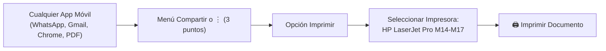

# 📱 Guía Oficial de Impresión Móvil — Servidor Privado Raspberry Pi 5

Guía paso a paso para imprimir documentos, fotos y correos desde teléfonos móviles y tablets (**Android** e **iOS / iPadOS**) conectados a la red Wi-Fi del hogar utilizando el servidor privado de impresión CUPS alojado en la **Raspberry Pi 5**.

---

## 📑 Índice de Contenidos
1. [Requisitos Previos de Red](#1-requisitos-previos-de-red)
2. [Impresión en Android (Zero-Config Nativo / Mopria)](#2-impresión-en-android-zero-config-nativo--mopria)
3. [Conexión Manual por IP en Android (Si el router tiene Aislamiento Wi-Fi)](#3-conexión-manual-por-ip-en-android-si-el-router-tiene-aislamiento-wi-fi)
4. [Impresión en iPhone y iPad (Apple AirPrint Nativo)](#4-impresión-en-iphone-y-ipad-apple-airprint-nativo)
5. [Ajustes de Márgenes, Escala y Formato A4 (Evitar marcos no deseados)](#5-ajustes-de-márgenes-escala-y-formato-a4-evitar-marcos-no-deseados)
6. [Cómo Ver y Gestionar la Cola de Impresión en Vivo (Web y PC)](#6-cómo-ver-y-gestionar-la-cola-de-impresión-en-vivo-web-y-pc)
7. [Cómo Imprimir desde las Apps más Populares](#7-cómo-imprimir-desde-las-apps-más-populares)
8. [Resolución de Problemas Frecuentes (Base de Conocimiento)](#8-resolución-de-problemas-frecuentes-base-de-conocimiento)

---

## 1. Requisitos Previos de Red

Para que el móvil o tablet se comunique con el servidor:
- **Estar conectado a la misma red Wi-Fi** que la Raspberry Pi (habitualmente la red Wi-Fi de tu router de casa).
- *Bandas 2.4 GHz y 5 GHz*: Puedes estar conectado a cualquiera de las dos; siempre que pertenezcan al mismo router local compartirán el direccionamiento (`192.168.1.x`).
- **IP Cableada del Servidor:** La Raspberry Pi debe operar preferentemente por cable Ethernet para máxima estabilidad (`192.168.1.XXX`).

---

## 2. Impresión en Android (Zero-Config Nativo / Mopria)

Todos los dispositivos Android modernos (marcas como Samsung, Xiaomi, Google Pixel, Motorola, Realme, Oppo, etc.) incorporan de fábrica soporte para impresión IPP mediante el **Servicio de Impresión del Sistema** o **Mopria Print Service**.

### Paso a paso para activar el servicio:
1. Abre los **Ajustes** de tu teléfono o tablet Android.
2. Navega a:
   - **Xiaomi / Redmi / POCO**: *Conexión y compartir > Impresión*.
   - **Samsung**: *Conexiones > Más ajustes de conexión > Imprimir*.
   - **Google Pixel / Motorola / Android Puro**: *Dispositivos conectados > Preferencias de conexión > Impresión*.
3. Comprueba que el **Servicio de impresión del sistema** (o **Mopria Print Service**) esté en **Activado**.
4. Verás aparecer inmediatamente la impresora disponible en la red:
   ```text
   HP LaserJet Pro M14-M17
   <IP_DEL_SERVIDOR> - Servidor Raspberry Pi 5
   ```
5. ¡Listo! Ya puedes imprimir directamente desde cualquier app.

> [!TIP]
> **Recomendación para usuarios Xiaomi (MIUI / HyperOS):**  
> Si experimentas retardos o avisos de retención en el servicio genérico del sistema, instala la aplicación oficial gratuita [**Mopria Print Service**](https://play.google.com/store/apps/details?id=org.mopria.printplugin) desde Google Play Store. Desarrollada por HP y Canon, gestiona el flujo de documentos sin saturar el spooler de Xiaomi.

---

## 3. Conexión Manual por IP en Android (Si el router tiene Aislamiento Wi-Fi)

> [!NOTE]
> **¿Por qué ocurre esto?**  
> Algunos routers de operadoras tienen habilitado por defecto **AP Isolation (Aislamiento de Clientes)** o filtrado multicast (`mDNS`). Esto impide que los dispositivos Wi-Fi vean paquetes de difusión local.

Si tu teléfono no detecta la impresora automáticamente, puedes vincularla directamente por su dirección IP:

1. Ve a **Ajustes > Impresión > Servicio de impresión del sistema** (o Mopria).
2. Pulsa en los **tres puntos verticales (Menú)** arriba a la derecha.
3. Selecciona **"Agregar impresora"** > **"Por dirección IP / Nombre de host"**.
4. Introduce los datos de conexión:
   * **Dirección IP del servidor:** `192.168.1.XXX`
   * *(O ruta IPP completa si la solicita)*:  
     `http://<IP_DEL_SERVIDOR>:631/printers/HP_LaserJet_M14_M17`
5. Pulsa **Guardar** o **Aceptar**. La impresora quedará registrada de forma permanente.

---

## 4. Impresión en iPhone y iPad (Apple AirPrint Nativo)

Los dispositivos Apple (iOS / iPadOS / macOS) funcionan sin aplicaciones externas gracias a la publicación mDNS del servicio AirPrint en la Raspberry Pi 5:

1. Conecta tu iPhone o iPad al Wi-Fi de casa.
2. Abre cualquier documento, foto, página web o correo.
3. Pulsa el botón **Compartir** (icono de cuadrado con flecha hacia arriba).
4. Desliza hacia abajo y pulsa en **Imprimir**.
5. En el campo **Impresora**, selecciónala: aparecerá como `HP LaserJet Pro M14-M17`.
6. Ajusta el número de copias o rango de páginas y pulsa **Imprimir**.

---

## 5. Ajustes de Márgenes, Escala y Formato A4 (Evitar marcos no deseados)

Uno de los problemas más frecuentes al imprimir desde móviles es que el documento salga con un marco blanco desproporcionado o con los márgenes encogidos. Esto ocurre por diferencias entre el formato **Carta (Letter)** y **A4**.

### A. Configuración en el Servidor (Raspberry Pi 5)
El servidor ya está configurado con:
* `PageSize = A4` (210 x 297 mm)
* `media = A4`
* `fit-to-page-default = true`
* `print-scaling-default = fill`

### B. Cómo ajustar el documento en el móvil al imprimir:
Cuando abras la pantalla de previsualización de impresión en tu móvil o tablet:
1. Despliega la flecha o toca en **"Más opciones"** (o menú de opciones avanzadas).
2. **Tamaño de papel:** Asegúrate de que esté seleccionado **A4** (no *Letter / Carta*).
3. **Escala / Ajuste de página:**
   * **Ajustar al área de impresión (Recomendado):** Escala el contenido del PDF para aprovechar toda la hoja A4 sin dejar marcos dobles.
   * **Rellenar página:** Elimina cualquier borde sobrante adaptando el PDF a los márgenes físicos de la impresora.
   * **Tamaño real:** Úsalo solo si el documento original ya fue diseñado exactamente en A4 y no quieres ninguna alteración de escala.

---

## 6. Cómo Ver y Gestionar la Cola de Impresión en Vivo (Web y PC)

¿Has mandado un trabajo y quieres saber si está en cola, completado o si hay algún documento atascado?

### A. Panel Web en Vivo (Accesible desde móvil, tablet o PC)
Abre tu navegador (Chrome, Safari, Edge, Firefox) e ingresa a:

```text
http://<IP_DEL_SERVIDOR>:631/jobs/
```

* **Trabajos en proceso:** Verás el ID del trabajo, nombre de archivo, usuario y tamaño.
* **Trabajos completados:** Pulsa en *"Show Completed Jobs"* para ver el historial reciente de impresiones finalizadas con éxito.
* **Cancelar trabajos atascados:** Puedes cancelar cualquier trabajo directamente pulsando en el botón **Cancel Job** del panel.

### B. Gestión desde la Consola de tu PC (deploy_remote.py)
Desde la carpeta del proyecto en tu ordenador puedes interactuar con el servidor mediante Python:

```bash
# Ver trabajos activos y completados en vivo
python deploy_remote.py --jobs

# Cancelar y purgar todos los trabajos retenidos
python deploy_remote.py --clear-jobs

# Reanudar la cola si se pausó por suspensión
python deploy_remote.py --unstick

# Diagnóstico general de salud del servidor
python deploy_remote.py --status
```

---

## 7. Cómo Imprimir desde las Apps más Populares



* **WhatsApp**: Abre el documento PDF recibido > Menú (3 puntos arriba a la derecha) > **Imprimir** (o Compartir > Imprimir).
* **Google Drive / Lector de PDF**: Abre el archivo > Menú (3 puntos) > **Imprimir** > Elige `HP LaserJet Pro M14-M17`.
* **Google Chrome**: 3 puntos arriba a la derecha > **Compartir...** > Icono **Imprimir**.
* **Galería / Fotos**: Abre la foto > Pulsa **Compartir** o los 3 puntos > **Imprimir** > Ajusta el tamaño de papel a A4.

---

## 8. Resolución de Problemas Frecuentes (Base de Conocimiento)

### ❓ 1. El móvil dice: *"Esta impresora ya no acepta trabajos encriptados. ¿Continuar imprimiendo?"*
* **Por qué ocurre:** Android recuerda que anteriormente la impresora intentó usar el canal seguro IPPS (`_ipps._tcp`). Al haber configurado el servidor en modo IPP estándar sin cifrado obligatorio (para evitar fallos de certificados autofirmados), Android muestra una advertencia de seguridad informativa.
* **Solución:**
  1. Pulsa en **"Continuar"** (o *"Aceptar"*). El documento se imprimirá normalmente.
  2. Si deseas que no vuelva a preguntar, ve a **Ajustes > Impresión > Servicio del sistema**, pulsa sobre la impresora, selecciona **Olvidar/Eliminar** y búscala de nuevo. Se registrará de cero sin mostrar más advertencias.

---

### ❓ 2. El móvil dice: *"La impresora ha bloqueado el archivo"* o luz naranja/ámbar parpadeando
* **Por qué ocurre:**  
  La HP LaserJet Pro M14-M17 cuenta con sensores automáticos de hardware. Si el cartucho de tóner está en umbral de **"Muy bajo"** (`status-code 1601`) o la bandeja se quedó momentáneamente sin papel o tuvo un atasco, **la impresora física se queda en pausa preventiva**.
* **Solución:**
  1. Observa el panel frontal de la impresora: si la luz naranja/ámbar está encendida o parpadeando, **pulsa el botón de la hoja de papel / flecha (botón Reanudar)**.
  2. La impresora confirmará la tirada con tóner bajo y comenzará a imprimir las páginas pendientes de la memoria.
  3. Si hubo un atasco mecánico de papel: abre la compuerta superior de la impresora, retira el cartucho de tóner, saca suavemente la hoja atascada, recoloca el tóner, cierra la compuerta y presiona el botón Reanudar.

---

### ❓ 3. En el móvil aparecía la IP `IP_WIFI_WLAN0` en vez de `192.168.1.XXX`
* **Por qué ocurría:** La Raspberry Pi tenía tanto el cable Ethernet (`.40`) como la Wi-Fi integrada (`.75`) activadas a la vez. Avahi emitía anuncios por ambas interfaces y los móviles Wi-Fi captaban la `.75`.
* **Solución aplicada:** Se ha configurado Avahi para usar exclusivamente `eth0` (`allow-interfaces=eth0`) y se ha desactivado la conexión Wi-Fi redundante. Ahora solo existe y se anuncia `192.168.1.XXX`.

---

### ❓ 4. El documento sale con marcos blancos dobles o contenido encogido
* **Por qué ocurría:** La cola de impresión tenía asignado por defecto el tamaño de papel americano `Letter` (215.9 x 279.4 mm), más corto que el `A4` europeo (210 x 297 mm).
* **Solución:** Se ha establecido `PageSize=A4` en el servidor. Al imprimir desde el móvil, entra en *Opciones avanzadas* y selecciona **A4** y **"Ajustar al área de impresión"**.

---

## 📊 Ficha Rápida de Parámetros de Red

| Parámetro | Valor para Clientes |
| :--- | :--- |
| **Nombre de Cola** | `HP_LaserJet_M14_M17` |
| **IP del Servidor** | `192.168.1.XXX` (Ethernet Cable) |
| **Puerto IPP** | `631` |
| **URL IPP Directa** | `http://<IP_DEL_SERVIDOR>:631/printers/HP_LaserJet_M14_M17` |
| **Monitor Web de Trabajos** | `http://<IP_DEL_SERVIDOR>:631/jobs/` |
| **Protocolo de difusión** | mDNS / DNS-SD (Avahi en `eth0`) |
| **Compatibilidad Móvil** | Apple AirPrint Nativo & Android Mopria 1.3 |
| **Tamaño Predeterminado** | A4 (210 x 297 mm) — Ajuste a márgenes |
